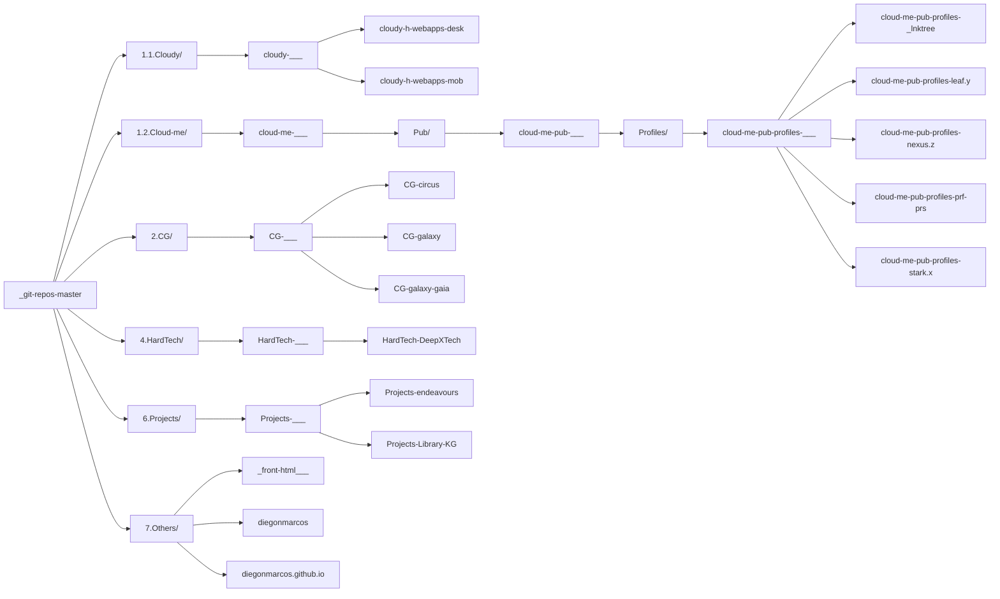

<!-- generated by scripts/gen-repos-tree.mjs - edit 00_repos-tree/src or the git-repos-master submodule, never this copy -->

<!-- GENERATED by gen-registry.js from projects-repos.json. DO NOT EDIT. Template: A0_repos-tree/src/repos-tree.md.tmpl -->

# Repos tree

Root -> numbered groups -> hubs -> repos. Source: `repos-tree.json` (this folder). Graph notes: [[_git-repos-master]] (folder `repos-tree/`). Also `repos-tree.canvas`, `repos-tree.xml`, `repos-tree.html`.
Every repo has a `kind`: `html` (a front/web page repo, mounted in `_front-html___`), `lfs` (uses Git LFS) or `code`; the columns "HTML repo?" and "LFS repo?" carry the two flags. Re-run the scan with `node 0_registry/scan-kinds.js`.

## Tree

### Full list (24 repos)

- **[[_git-repos-master]]** · 🌐 public · Repos · 💻 code
  - 📁 **1.1.Cloudy/** · Cloudy (1.1): hub cloudy-___ and its members. The cloudy project: fleet infrastructure, services, devices, data and docs.
    - **[[cloudy-___]]** · 🌐 public · Cloudy · 💻 code
      - [[cloudy-h-webapps-desk]] · 🌐 public · Cloudy · 🌐 HTML
      - [[cloudy-h-webapps-mob]] · 🌐 public · Cloudy · 🌐 HTML
  - 📁 **1.2.Cloud-me/** · Cloud-Me (1.2): hub cloud-me-___ and its members. The owner's personal cloud: public profiles and shared data, private configs, data and secrets.
    - **[[cloud-me-___]]** · 🌐 public · Cloud-Me · 💻 code
      - 📁 **Pub/**
        - **[[cloud-me-pub-___]]** · 🌐 public · Cloud-Me · 💻 code
          - 📁 **Profiles/**
            - **[[cloud-me-pub-profiles-___]]** · 🌐 public · Cloud-Me · 💻 code
              - [[cloud-me-pub-profiles-_lnktree]] · 🌐 public · Cloud-Me · 🌐 HTML
              - [[cloud-me-pub-profiles-leaf.y]] · 🌐 public · Cloud-Me · 🌐 HTML
              - [[cloud-me-pub-profiles-nexus.z]] · 🌐 public · Cloud-Me · 🌐 HTML
              - [[cloud-me-pub-profiles-prf-prs]] · 🌐 public · Cloud-Me · 🌐 HTML
              - [[cloud-me-pub-profiles-stark.x]] · 🌐 public · Cloud-Me · 🌐 HTML
  - 📁 **2.CG/** · CG (2): hub CG-___ and its members. Computer graphics: 3D worlds, engines and media production.
    - **[[CG-___]]** · 🌐 public · 💻 code
      - [[CG-circus]] · 🌐 public · Zirkus · 🌐 HTML
      - [[CG-galaxy]] · 🌐 public · Galaxy · 🌐 HTML
      - [[CG-galaxy-gaia]] · 🔒 private · Galaxy · 🌐 HTML
  - 📁 **4.HardTech/** · HardTech (4): hub HardTech-___ and its members. HardTech: deep science projects and CAD / simulation tools.
    - **[[HardTech-___]]** · 🌐 public · 💻 code
      - [[HardTech-DeepXTech]] · 🌐 public · DeepXTech · 🌐 HTML
  - 📁 **6.Projects/** · Projects (6): hub Projects-___ and its members. Projects (formerly Front): endeavours, lab tools and DuckPeng.
    - **[[Projects-___]]** · 🌐 public · 💻 code
      - [[Projects-endeavours]] · 🌐 public · Endeavours · 🌐 HTML
      - [[Projects-Library-KG]] · 🌐 public · Library-KG · 🌐 HTML
  - 📁 **7.Others/** · Others (7): no hub. Loose GitHub repos with no project hub (profile README, GitHub Pages site).
    - [[_front-html___]] · 🌐 public · Pages · 🌐 HTML
    - [[diegonmarcos]] · 🌐 public · Profile · 🌐 HTML
    - [[diegonmarcos.github.io]] · 🌐 public · Pages · 🌐 HTML

### HTML repos (16)

- **[[_git-repos-master]]** · 🌐 public · Repos · 💻 code
  - 📁 **1.1.Cloudy/** · Cloudy (1.1): hub cloudy-___ and its members. The cloudy project: fleet infrastructure, services, devices, data and docs.
    - **[[cloudy-___]]** · 🌐 public · Cloudy · 💻 code
      - [[cloudy-h-webapps-desk]] · 🌐 public · Cloudy · 🌐 HTML
      - [[cloudy-h-webapps-mob]] · 🌐 public · Cloudy · 🌐 HTML
  - 📁 **1.2.Cloud-me/** · Cloud-Me (1.2): hub cloud-me-___ and its members. The owner's personal cloud: public profiles and shared data, private configs, data and secrets.
    - **[[cloud-me-___]]** · 🌐 public · Cloud-Me · 💻 code
      - 📁 **Pub/**
        - **[[cloud-me-pub-___]]** · 🌐 public · Cloud-Me · 💻 code
          - 📁 **Profiles/**
            - **[[cloud-me-pub-profiles-___]]** · 🌐 public · Cloud-Me · 💻 code
              - [[cloud-me-pub-profiles-_lnktree]] · 🌐 public · Cloud-Me · 🌐 HTML
              - [[cloud-me-pub-profiles-leaf.y]] · 🌐 public · Cloud-Me · 🌐 HTML
              - [[cloud-me-pub-profiles-nexus.z]] · 🌐 public · Cloud-Me · 🌐 HTML
              - [[cloud-me-pub-profiles-prf-prs]] · 🌐 public · Cloud-Me · 🌐 HTML
              - [[cloud-me-pub-profiles-stark.x]] · 🌐 public · Cloud-Me · 🌐 HTML
  - 📁 **2.CG/** · CG (2): hub CG-___ and its members. Computer graphics: 3D worlds, engines and media production.
    - **[[CG-___]]** · 🌐 public · 💻 code
      - [[CG-circus]] · 🌐 public · Zirkus · 🌐 HTML
      - [[CG-galaxy]] · 🌐 public · Galaxy · 🌐 HTML
      - [[CG-galaxy-gaia]] · 🔒 private · Galaxy · 🌐 HTML
  - 📁 **4.HardTech/** · HardTech (4): hub HardTech-___ and its members. HardTech: deep science projects and CAD / simulation tools.
    - **[[HardTech-___]]** · 🌐 public · 💻 code
      - [[HardTech-DeepXTech]] · 🌐 public · DeepXTech · 🌐 HTML
  - 📁 **6.Projects/** · Projects (6): hub Projects-___ and its members. Projects (formerly Front): endeavours, lab tools and DuckPeng.
    - **[[Projects-___]]** · 🌐 public · 💻 code
      - [[Projects-endeavours]] · 🌐 public · Endeavours · 🌐 HTML
      - [[Projects-Library-KG]] · 🌐 public · Library-KG · 🌐 HTML
  - 📁 **7.Others/** · Others (7): no hub. Loose GitHub repos with no project hub (profile README, GitHub Pages site).
    - [[_front-html___]] · 🌐 public · Pages · 🌐 HTML
    - [[diegonmarcos]] · 🌐 public · Profile · 🌐 HTML
    - [[diegonmarcos.github.io]] · 🌐 public · Pages · 🌐 HTML

### LFS repos (0)

_none_

## Table

### Full list

| Repo | Code | Kind | HTML repo? | LFS repo? | Visibility | Project | Language | Description |
|---|---|---|---|---|---|---|---|---|
| [[_git-repos-master]] | `0` | code | no | no | 🌐 public | Repos | HTML | — |
| [[cloudy-___]] | `1.1.0` | code | no | no | 🌐 public | Cloudy | Shell | — |
| [[cloudy-h-webapps-desk]] | `1.1.4.2` | html | yes | no | 🌐 public | Cloudy | HTML | Front group c_Suite (split from front-projects, #1072) |
| [[cloudy-h-webapps-mob]] | `1.1.4.1` | html | yes | no | 🌐 public | Cloudy | TypeScript | Cloud web apps: per-app independent sites with a shared top nav |
| [[cloud-me-___]] | `1.2.0` | code | no | no | 🌐 public | Cloud-Me | Shell | cloud-me hub: the owner's configs across the cloud — links the cloud-me-pub-___ and cloud-me-pvt-___ hubs |
| [[cloud-me-pub-___]] | `1.2.1.0` | code | no | no | 🌐 public | Cloud-Me | Shell | Cloud-Me-Pub hub: index of the public cloud-me family |
| [[cloud-me-pub-profiles-___]] | `1.2.1.1.0` | code | no | no | 🌐 public | Cloud-Me | Shell | Front group b_Profiles (split from front-projects, #1072) |
| [[cloud-me-pub-profiles-_lnktree]] | `1.2.1.1.1` | html | yes | no | 🌐 public | Cloud-Me | JavaScript | Linktree site (split from Me-Profiles) |
| [[cloud-me-pub-profiles-leaf.y]] | `1.2.1.1.2` | html | yes | no | 🌐 public | Cloud-Me | HTML | Leaf.y — company site |
| [[cloud-me-pub-profiles-nexus.z]] | `1.2.1.1.3` | html | yes | no | 🌐 public | Cloud-Me | HTML | Nexus.z — company site |
| [[cloud-me-pub-profiles-prf-prs]] | `1.2.1.1.4` | html | yes | no | 🌐 public | Cloud-Me | JavaScript | Professional and personal profiles (split from Me-Profiles) |
| [[cloud-me-pub-profiles-stark.x]] | `1.2.1.1.5` | html | yes | no | 🌐 public | Cloud-Me | TypeScript | Stark.x — company site |
| [[CG-___]] | `2.0` | code | no | no | 🌐 public | — | Shell | CG — master index of the CG-* repos (circus, galaxy, galaxy-gaia, unity, voxel-rust) |
| [[CG-circus]] | `2.2.4.1` | html | yes | no | 🌐 public | Zirkus | JavaScript | Front group c_Circus (split from front-projects, #1072) |
| [[CG-galaxy]] | `2.1.1.1` | html | yes | no | 🌐 public | Galaxy | JavaScript | Front group b_Projects (split from front-projects, #1072) |
| [[CG-galaxy-gaia]] | `2.1.1.2` | html | yes | no | 🔒 private | Galaxy | Python | front-galaxy-gaia |
| [[HardTech-___]] | `4.0` | code | no | no | 🌐 public | — | Shell | DeepSc — hub: deep science (StarkX, X) |
| [[HardTech-DeepXTech]] | `4.2.1.1` | html | yes | no | 🌐 public | DeepXTech | Shell | DeepSc-X — deep science projects |
| [[Projects-___]] | `6.0` | code | no | no | 🌐 public | — | Shell | Registry index for the front-* repo family (front-master, mirrors cloud-master) |
| [[Projects-endeavours]] | `6.1.1.1` | html | yes | no | 🌐 public | Endeavours | JavaScript | Front group a_Companies (split from front-projects, #1072) |
| [[Projects-Library-KG]] | `6.3.1.1` | html | yes | no | 🌐 public | Library-KG | HTML | Chronos: interactive simulators of cycles across scales - circadian, Earth, Milky Way and quantum. |
| [[_front-html___]] | `7.2.1.2` | html | yes | no | 🌐 public | Pages | — | — |
| [[diegonmarcos]] | `7.1.1.1` | html | yes | no | 🌐 public | Profile | TypeScript | GitHub Landpage |
| [[diegonmarcos.github.io]] | `7.2.1.1` | html | yes | no | 🌐 public | Pages | TypeScript | Does Ducks lives in the north pole with bears or south with Penguins?  |

### HTML repos

| Repo | Code | Kind | HTML repo? | LFS repo? | Visibility | Project | Language | Description |
|---|---|---|---|---|---|---|---|---|
| [[cloudy-h-webapps-desk]] | `1.1.4.2` | html | yes | no | 🌐 public | Cloudy | HTML | Front group c_Suite (split from front-projects, #1072) |
| [[cloudy-h-webapps-mob]] | `1.1.4.1` | html | yes | no | 🌐 public | Cloudy | TypeScript | Cloud web apps: per-app independent sites with a shared top nav |
| [[cloud-me-pub-profiles-_lnktree]] | `1.2.1.1.1` | html | yes | no | 🌐 public | Cloud-Me | JavaScript | Linktree site (split from Me-Profiles) |
| [[cloud-me-pub-profiles-leaf.y]] | `1.2.1.1.2` | html | yes | no | 🌐 public | Cloud-Me | HTML | Leaf.y — company site |
| [[cloud-me-pub-profiles-nexus.z]] | `1.2.1.1.3` | html | yes | no | 🌐 public | Cloud-Me | HTML | Nexus.z — company site |
| [[cloud-me-pub-profiles-prf-prs]] | `1.2.1.1.4` | html | yes | no | 🌐 public | Cloud-Me | JavaScript | Professional and personal profiles (split from Me-Profiles) |
| [[cloud-me-pub-profiles-stark.x]] | `1.2.1.1.5` | html | yes | no | 🌐 public | Cloud-Me | TypeScript | Stark.x — company site |
| [[CG-circus]] | `2.2.4.1` | html | yes | no | 🌐 public | Zirkus | JavaScript | Front group c_Circus (split from front-projects, #1072) |
| [[CG-galaxy]] | `2.1.1.1` | html | yes | no | 🌐 public | Galaxy | JavaScript | Front group b_Projects (split from front-projects, #1072) |
| [[CG-galaxy-gaia]] | `2.1.1.2` | html | yes | no | 🔒 private | Galaxy | Python | front-galaxy-gaia |
| [[HardTech-DeepXTech]] | `4.2.1.1` | html | yes | no | 🌐 public | DeepXTech | Shell | DeepSc-X — deep science projects |
| [[Projects-endeavours]] | `6.1.1.1` | html | yes | no | 🌐 public | Endeavours | JavaScript | Front group a_Companies (split from front-projects, #1072) |
| [[Projects-Library-KG]] | `6.3.1.1` | html | yes | no | 🌐 public | Library-KG | HTML | Chronos: interactive simulators of cycles across scales - circadian, Earth, Milky Way and quantum. |
| [[_front-html___]] | `7.2.1.2` | html | yes | no | 🌐 public | Pages | — | — |
| [[diegonmarcos]] | `7.1.1.1` | html | yes | no | 🌐 public | Profile | TypeScript | GitHub Landpage |
| [[diegonmarcos.github.io]] | `7.2.1.1` | html | yes | no | 🌐 public | Pages | TypeScript | Does Ducks lives in the north pole with bears or south with Penguins?  |

### LFS repos

| Repo | Code | Kind | HTML repo? | LFS repo? | Visibility | Project | Language | Description |
|---|---|---|---|---|---|---|---|---|

## Mermaid



## Dataview

```dataview
TABLE row["group"] AS "group", hub, project, area, family, visibility, developer, kind
FROM "A0_repos-tree/dist/repos-tree" AND #repo
SORT row["group"] ASC, file.name ASC
```
